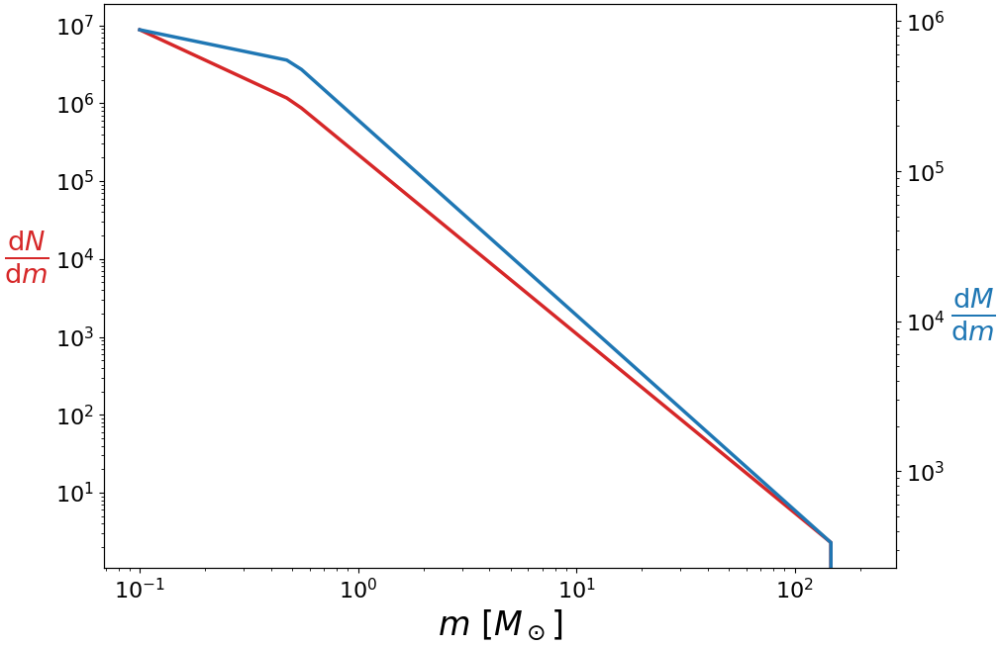
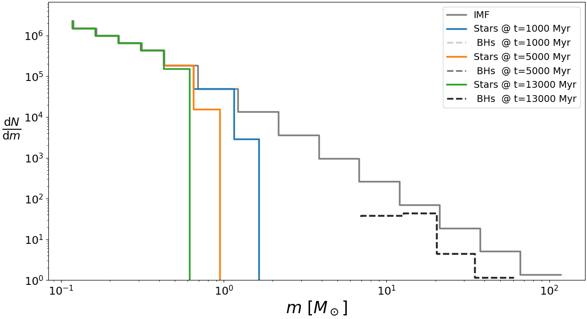
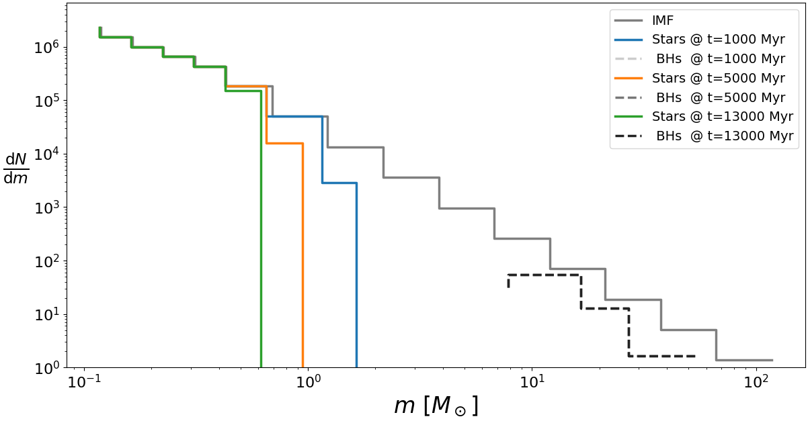
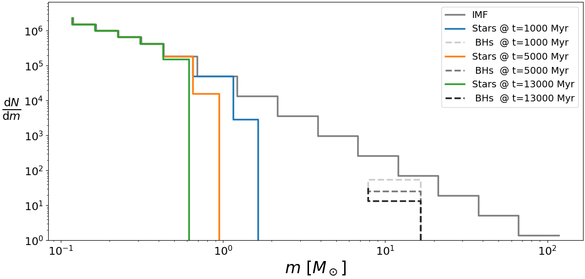
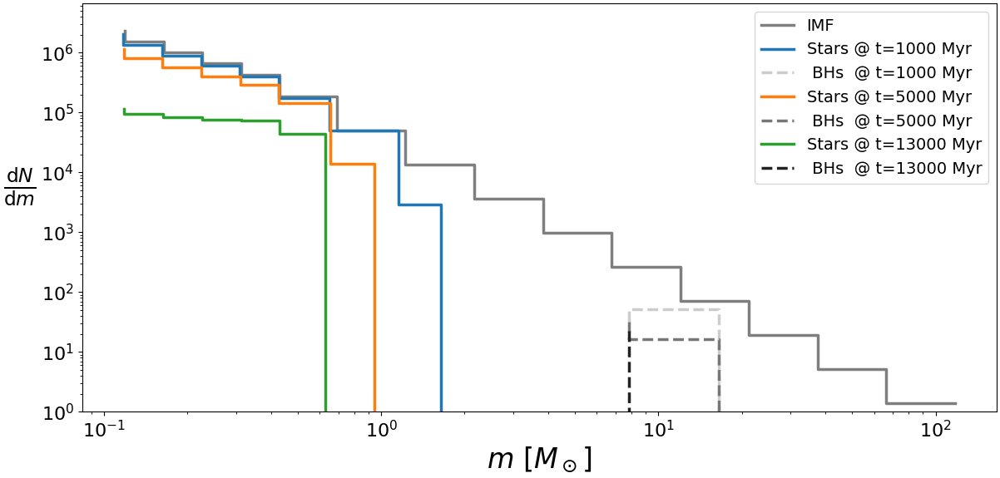
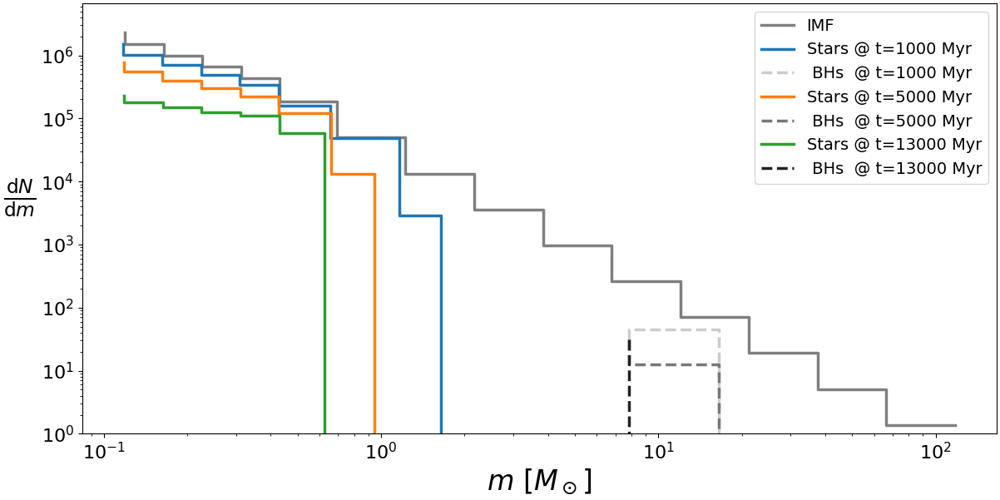

=====
Usage
=====

To use SSPTools in a project::

    import ssptools

Mass Functions
==============

The main functionality of ``ssptools`` is provided through the mass function
(MF) evolution classes.

Initial Mass Functions
----------------------

All MF classes must be instantiated from an initial mass function (IMF).
This is defined, such as in :class:`ssptools.masses.PowerLawIMF`, based on the
shape of the IMF and the total number of stars.

.. code-block:: python

   >>> m_break, a_slopes = [0.1, 0.5, 150.], [-1.3, -2.3]
   >>> imf = ssptools.masses.PowerLawIMF(m_break, a_slopes, N0=5e5)

Note that by default this IMF is normalized to ``N0=1``.

The IMF can also be created based on the total initial stellar mass:

.. code-block:: python

    >>> imf_m = ssptools.masses.PowerLawIMF.from_M0(m_break, a_slopes, M0=1e6)

This IMF class can be easily evaluated to determine the number of (or mass in)
stars of a given mass.

.. code-block:: python

    >>> import numpy as np
    >>> import matplotlib.pyplot as plt

    >>> m_ini = np.geomspace(0.1, 200)

    >>> plt.loglog(m_ini, imf(m_ini), color='tab:red')
    >>> plt.ylabel(r"$\frac{\mathrm{d}N}{\mathrm{d}m}$", rotation=0, color='tab:red', ha='right')
    >>> plt.xlabel(r"$m\ [M_\odot]$")
    >>> plt.twinx().loglog(m_ini, imf.M(m_ini), color='tab:blue')
    >>> plt.ylabel(r"$\frac{\mathrm{d}M}{\mathrm{d}m}$", rotation=0, color='tab:blue', ha='left')
    >>> plt.show()

The IMF class can also be integrated to give the total mass or counts between
some mass limits.

.. code-block:: python

    >>> imf.Mtot == imf.integrate_M(0.1, 150.)
    True

The behaviour of this class outside the boundaries specified by ``m_break``
is controlled by the ``ext`` argument, and by default there is always zero
mass outside these bounds.

Evolved Mass Functions
----------------------

A mass function can be evolved to a given age using the
:class:`ssptools.EvolvedMF`. This class is initialized, at a minimum, using an
IMF, a configuration of mass bins, a metallicity, output ages and a rate of
dynamical escapes.

.. raw:: html

   

   
<a>show plotting function</a>

.. code-block:: python

   def plot_MF(pdmf):

       fig, ax = plt.subplots(layout='constrained')

       mes, mew, _, meb = pdmf.massbins.bins

       # ax.step(np.mean(mes, axis=0), pdmf.IMF.binned_N(mes))
       ax.step(np.mean(mes, axis=0),
               pdmf.IMF.binned_N(mes, N=pdmf.N0) / (mes.upper - mes.lower),
               color=('k', 0.5), label='IMF')

       for i in range(pdmf.nout):
           ax.step(pdmf.ms[i], pdmf.Ns[i] / (mes.upper - mes.lower),
                   ls='-', label=f"Stars @ t={pdmf.tout[i]} Myr")

           ax.step(pdmf.mr.WD[i], pdmf.Nr.WD[i] / (mew.upper - mew.lower),
                   # ls='--', c=str(0.8 * 1 - (i / pdmf.nout)),
                   ls=':', label=f" WD  @ t={pdmf.tout[i]} Myr")

           ax.step(pdmf.mr.BH[i], pdmf.Nr.BH[i] / (meb.upper - meb.lower),
                   ls='--', c=str(0.8 * 1 - (i / pdmf.nout)),
                         label=f" BHs  @ t={pdmf.tout[i]} Myr")

       ax.set_ylabel(r"$\frac{\mathrm{d}N}{\mathrm{d}m}$", rotation=0)
       ax.set_xlabel(r"$m\ [M_\odot]$")
       ax.set_yscale('log')
       ax.set_xscale('log')
       ax.set_ylim(bottom=1)
       ax.legend()

       return fig

.. raw:: html

   

.. code-block:: python

    >>> nbins, FeH, tout = [5, 10], -1.5, [1000, 5000, 13000]

    >>> pdmf = ssptools.EvolvedMF(imf, N0=imf.N0, nbins=nbins, FeH=FeH, tout=tout, esc_rate=0)

Note again here that ``N0`` defaults to ``N0=5e5``. if ``N0=None``, the ``N0``
will be taken from ``imf.N0``. It is good practice to make sure the two match,
but not absolutely necessary.

The evolved MF classes are based on a set of mass bins, representing the
total mass and number of stars and stellar remnants with individual masses in a
given bin. The number of mass bins is split between the break masses of the IMF,
either evenly (if a single integer is given) or based on a given list. Within
the breaks the bins may be distributed either linearly or in log-space (based on
the ``binning_method`` argument).

By default the mass bins which all remnants are placed into will be constructed
to (more or less) match the edges of stellar mass bins. The remnant bins
can also be set more explicitly by passing a dictionary of bins for each star
and remnant type:

.. code-block:: python

    >>> nbins_map = dict(MS=[5, 10], WD=5, BH=5, NS=1)
    >>> pdmf = ssptools.EvolvedMF(imf, nbins=nbins_map, FeH=FeH, tout=tout, esc_rate=0)

The time step(s) at which the mass function will be stored are given by the
``tout`` argument, in Myrs. The last time step given is taken as the final
age of the system.

The total mass, total number and mean mass in each mass bin at this final age,
for all stars and remnants, are stored in single arrays:

.. code-block:: python

    >>> pdmf.M
    array([10309.95512311, 12915.54020001, 16179.62218712, ...,
            9021.12173492,  6747.15167363,  3365.55098342], shape=(13,))
    >>> pdmf.N
    array([8.76213992e+04, 7.95558250e+04, 7.22326891e+04, ...,
           5.47855024e+02, 2.50907637e+02, 6.09851939e+01], shape=(13,))
    >>> pdmf.m
    array([ 0.11766481,  0.16234563,  0.22399308, ..., 16.46625722,
           26.8909777 , 55.18636193], shape=(13,))

These arrays are not by mass bin, but by object type, and the type of object
stored in each bin is found in the ``types`` array:

.. code-block:: python

    >>> pdmf.M[pdmf.types == 'BH']  # Black holes only
    array([1284.98375844, 9021.12173492, 6747.15167363, 3365.55098342])

Note that the number of bins in these arrays *do not* match ``nbins`` exactly.
This is because all empty bins (defined as N<1, by default) are stripped from
these final output arrays.

The total number and mass of stars in all mass bins are also stored at
each time step as separate attributes:

.. code-block:: python

    >>> (pdmf.nout, pdmf.massbins.nbin.MS)
    (3, 15)

    >>> pdmf.Ms
    array([[1.03099551e+04, 1.29155402e+04, 1.61796222e+04, ...,
            3.51683035e+00, 6.21599494e+00, 1.08664183e+01],
           [1.03099551e+04, 1.29155402e+04, 1.61796222e+04, ...,
            3.51683035e+00, 6.21599494e+00, 1.08664183e+01],
           [1.03099551e+04, 1.29155402e+04, 1.61796222e+04, ...,
            3.51683035e+00, 6.21599494e+00, 1.08664183e+01]], shape=(3, 15))

    >>> pdmf.Ns
    array([[8.76213992e+04, 7.95558250e+04, 7.22326891e+04, ...,
            9.97044905e-02, 9.96235073e-02, 9.84522101e-02],
           [8.76213992e+04, 7.95558250e+04, 7.22326891e+04, ...,
            9.97044905e-02, 9.96235073e-02, 9.84522101e-02],
           [8.76213992e+04, 7.95558250e+04, 7.22326891e+04, ...,
            9.97044905e-02, 9.96235073e-02, 9.84522101e-02]], shape=(3, 15))

    >>> pdmf.ms
    array([[  0.11766481,   0.16234563,   0.22399308, ...,  35.27253716,
             62.39486152, 110.37251803],
           [  0.11766481,   0.16234563,   0.22399308, ...,  35.27253716,
             62.39486152, 110.37251803],
           [  0.11766481,   0.16234563,   0.22399308, ...,  35.27253716,
             62.39486152, 110.37251803]], shape=(3, 15))

The same quantities for each remnant type (WD, NS, BH) are stored within a
named-tuple:

.. code-block:: python

    >>> type(pdmf.Mr)
    <class 'ssptools.masses.rem_classes'>

    >>> pdmf.Mr.WD
    array([[ 0.    ,  0.    ,  0.    ,  2321.0070448 , 17010.44848232],
           [ 0.    ,  0.    ,  0.    , 20295.74113431, 17010.44848232],
           [ 0.    ,  0.    ,  0.    , 34264.1152363 , 17010.44848232]], shape=(3, 5))

    >>> pdmf.Mr.NS
    array([[709.29872056],
           [709.29872056],
           [709.29872056]])

    >>> pdmf.Mr.BH
    array([[1284.98375844, 9021.12173492, 6747.15167363, 3365.55098342, 0.        ],
           [1284.98375844, 9021.12173492, 6747.15167363, 3365.55098342, 0.        ],
           [1284.98375844, 9021.12173492, 6747.15167363, 3365.55098342, 0.        ]], shape=(3, 5))

As seen here, the amount of BHs in this setup does not change over time. This is
not realistic, but simply due to the fact that the dynamical ejections are
computed after the fact and applied equally for each output time step, based on
the singular ``BH_ret_dyn`` retention parameter.
Therefore extra care should be taken when examining the BHs at multiple ages
through this method.

If instead the evolution of the BHs is known over time (in terms of the mass
fraction :math:`f_{BH}`), then the second mass function class
(:class:`ssptools.EvolvedMFWithBH`) should be used.

.. code-block:: python

    >>> fbh_target = [0.05, 0.03, 0.02]
    >>> pdmf = ssptools.EvolvedMFWithBH(imf, nbins=nbins_map, FeH=FeH, tout=tout, esc_rate=0, f_BH=fbh_target)

    >>> pdmf.Mr.BH
    array([[1.28498376e+03, 9.02112173e+03, 8.61184372e+00, 0.00000000e+00, 0.00000000e+00],
           [1.28498376e+03, 4.26412919e+03, 0.00000000e+00, 0.00000000e+00, 0.00000000e+00],
           [1.28498376e+03, 2.24819165e+03, 0.00000000e+00, 0.00000000e+00, 0.00000000e+00]], shape=(3, 5))

    >>> pdmf.Mr.BH.sum(axis=1)
    array([10314.71733708,  5549.11294948,  3533.17540509])

The escape of stars over time through, e.g., tidal losses from the system to an
external potential can be included through the ``esc_rate`` argument.
This represents the total escape rate through these mechanisms, in units of
stars (if ``esc_norm="N"``) or :math:`M_\odot` (if ``esc_norm="M"``) per Myr.

.. code-block:: python

    >>> esc_rate = -10  # Msun / Myr
    >>> pdmf = ssptools.EvolvedMFWithBH(imf, nbins=nbins_map, FeH=FeH, tout=tout, f_BH=fbh_target, esc_rate=esc_rate, esc_norm='M')

Passing a float will result in a constant escape rate. If known, a
function defining the escape rate over time can also be used. This function must
accept a single time argument, in Myrs, and return a rate in correct units.

.. code-block:: python

    >>> def M_dot_t(t: float) -> float:
    ...     return -500 / (t + 1)**0.5

    >>> pdmf = ssptools.EvolvedMFWithBH(imf, nbins=nbins_map, FeH=FeH, tout=tout, f_BH=fbh_target, esc_rate=M_dot_t, esc_norm='M')

For more details on all the available arguments, see :class:`ssptools.EvolvedMF`
and :class:`ssptools.EvolvedMFWithBH`.

Initial Black Hole Mass Function
--------------------------------

The mass function of all BHs which will form based on some IMF can be very
rapidly computed using the :class:`ssptools.InitialBHPopulation` class.

.. code-block:: python

    >>> bhmf = ssptools.InitialBHPopulation.from_IMF(imf, FeH=FeH, nbins=10)

    >>> bhmf.M
    array([   72.81007153,  5318.57848931, 29892.46915972, 10024.71039991,
            7850.06673955,     0.        ])

    >>> bhmf.N
    array([  10.22942788,  385.41561753, 1454.10264959,  287.99518655,
            129.92749573,    0.        ])

The same arguments surrounding the bin sizes apply as in the full mass function
classes, however only the BH bins are filled.

The age at which all BHs will have formed (``bhmf.age``), as well as the mass
of stars which will be lost when forming these BHs (``bhmf.Ms_lost``), are
also available.

Initial-Final Mass Relations
============================

The relationship between the initial ZAMS mass of stars and the remnant they
will form is the initial-final mass relation (IFMR). The exact form of the IFMR
is given by a combination of the effects of stellar evolution and winds, and of
the supernovae explosions (SNe).

SSPTools offers a number of different IFMR prescriptions, most of which are
based on pre-computed grids of stellar evolution models, interpolated across
metallicities.

The IFMRs can be examined and used directly through the
:class:`ssptools.ifmr.IFMR` class.

.. code-block:: python

    >>> ifm = ssptools.ifmr.IFMR(FeH=FeH)

    >>> # BH IFMRs based on SSE
    >>> ifm = ssptools.ifmr.IFMR(FeH=FeH, BH_method='ba20-rapid')
    >>> ifm_d = ssptools.ifmr.IFMR(FeH=FeH, BH_method='ba20-delayed')
    >>> ifm_rp = ssptools.ifmr.IFMR(FeH=FeH, BH_method='ba20-rapid-ppsn')

    >>> # BH IFMRs based on SEVN / PARSEC
    >>> ifm_sr = ssptools.ifmr.IFMR(FeH=FeH, BH_method='sevn-rapid')
    >>> ifm_sd = ssptools.ifmr.IFMR(FeH=FeH, BH_method='sevn-delayed')

    >>> # BH IFMRs based on COSMIC
    >>> ifm_cr = ssptools.ifmr.IFMR(FeH=FeH, BH_method='cosmic-rapid')
    >>> ifm_cd = ssptools.ifmr.IFMR(FeH=FeH, BH_method='cosmic-delayed')

More fine-grained control of the IFMR can be had by directly building the IFMR
using COSMIC.
This requires that COSMIC is installed, and is notably slower than the
pre-computed options.

.. code-block:: python

    >>> cosmic_kw = dict(remnantflag=3, windflag=3, pisn=-3, max_mi=300.)
    >>> ifm_f = ssptools.ifmr.IFMR(FeH=FeH, BH_method='cosmic', BH_kwargs=cosmic_kw)

Aside from the IFMRs based on physically motivated models, a simple broken power
law can also be used.

.. code-block:: python

    >>> pl_kw = dict(exponents=[1, 0.5, 1.5], slopes=[1, 2, 0.01], m_breaks=[20, 25, 30, 200])
    >>> ifm_pl = ssptools.ifmr.IFMR(FeH=FeH, BH_method='brokenpowerlaw', BH_kwargs=pl_kw)

The WD IFMR can either be taken from the MIST (2018) models, or use a simple
linear function, in the same manner as the BH IFMR. All NS are given the same
mass, though this mass can also be given here.

All of these methods and IFMR parameters can be passed to each of the mass
function classes discussed above.

The :class:`ssptools.ifmr.IFMR` class provides functions which predict both the
final remnant mass of a star (given its ZAMS mass) and the type of remnant it
will form. The type of remnant is defined by the maximum masses which will
form a WD and the minimum mass which will form a BH, both of which depend on the
IFMR methods chosen.

.. code-block:: python

    >>> m_ini = np.geomspace(0.7, 200)

    >>> ifm.predict(m_ini)
    array([ 0.5511784 ,  0.58557604,  0.60972914, ..., 68.15653659,
       72.17099957, 77.1543    ], shape=(50,))

    >>> np.array(ifm.predict_type(m_ini))
    array(['WD', 'WD', 'WD', ..., 'BH', 'BH', 'BH'], shape=(50,), dtype='<U2')

    >>> ifm.WD_mi
    bounds(lower=0.0, upper=np.float64(5.38232341594))
    >>> ifm.BH_mi
    bounds(lower=np.float64(20.2), upper=np.float64(250.0))

Black Hole Natal Kicks
======================

As BHs are formed, the amount which are retained in the system will depend
on the natal kicks they receive from their SNe.

In the case of binned collections of stars, rather than individual objects,
the impacts of kicks are modelled in SSPTools based on probabilistic functions
which define an overall retention fraction :math:`f_{ret}` as a function of
initial (ZAMS) stellar mass.

These retention functions can be examined and used directly through the
:class:`ssptools.kicks.kick_retention_fraction` function.

.. code-block:: python

    >>> m_ini = np.geomspace(15, 200)

    >>> ssptools.kicks.kick_retention_fraction(m_ini, vesc=90, FeH=FeH)
    array([0.01006539, 0.01006539, 0.01006539, ..., 1.        , 1.        ,
           1.        ], shape=(50,))

Two classes of methods are available; Maxwellian and analytical methods.

Maxwellian models draw the natal kicks from a Maxwellian velocity distribution
and determine the retention fraction by integrating the distribution up to the
system escape velocity.
Similar to the IFMRs, the strength of the kicks depend on the exact supernovae
prescriptions, and SSPTools allows for the use of many of the same models as
in the BH IFMRs here.

.. code-block:: python

    >>> ssptools.kicks.kick_retention_fraction(m_ini, method='maxwellian', FeH=FeH, vesc=90, SNe_method='rapid')
    array([0.01006539, 0.01006539, 0.01006539, ..., 1.        , 1.        ,
           1.        ], shape=(50,))
    >>> ssptools.kicks.kick_retention_fraction(m_ini, method='maxwellian', FeH=FeH, vesc=90, SNe_method='delayed')
    array([0.01006539, 0.01006539, 0.01006539, ..., 1.        , 1.        ,
           1.        ], shape=(50,))
    >>> ssptools.kicks.kick_retention_fraction(m_ini, method='maxwellian', FeH=FeH, vesc=90, SNe_method='sevn-rapid')
    array([0.01006539, 0.01006539, 0.01006539, ..., 1.        , 0.01006539,
           0.01006539], shape=(50,))

Aside from the kick distributions based on physically motivated models, simpler
analytical retention functions can also be used.

.. code-block:: python

    >>> ssptools.kicks.kick_retention_fraction(m_ini, method='tanh', slope=1, scale=25)
    array([0., 0., 0., ..., 1., 1., 1.], shape=(50,))

When using these analytical methods to determine the kicks for a full system
(e.g. in the above mass function classes), rather than specifying the scale
directly, a total fraction of BH mass to be kicked (:math:`f_{kick}`) can be
supplied, which will be used to determine the required scale parameter.

.. code-block:: python

    >>> f_kick = 0.5
    >>> kick_slope, kick_scale = ssptools.kicks._determine_kick_params('tanh', f_kick, imf, ifm, 1.0, 20)
    >>> kick_scale
    39.97441121168542
    >>> ssptools.kicks.kick_retention_fraction(m_ini, method='tanh', slope=kick_slope, scale=kick_scale)
    array([0., 0., 0., ..., 1., 1., 1.], shape=(50,))

All of these methods and kicks parameters can be passed to each of the mass
function classes discussed above. It is recommended that the IFMR and kick
methods be matched to ensure consistent modelling.

